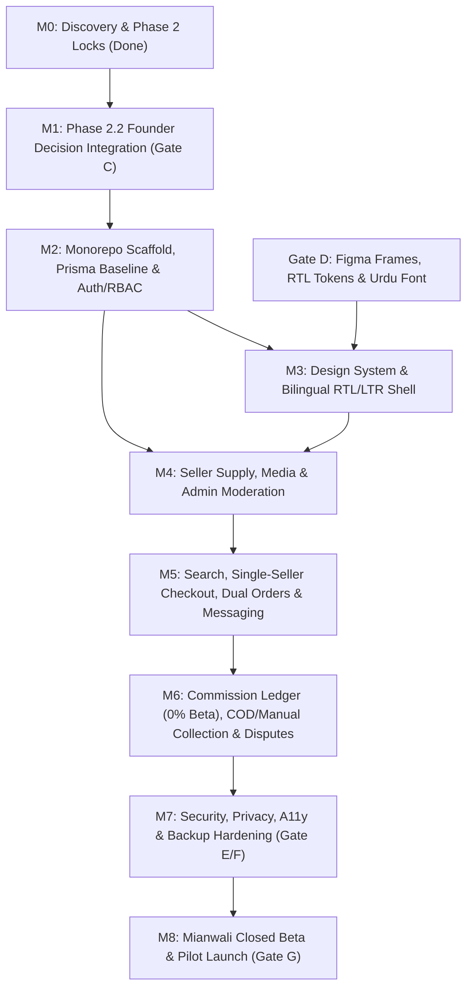

# Implementation Plan

> Status: Phase 2.2 Baseline — Founder Decisions `PQ-01`–`PQ-16` Integrated (`docs/21_PHASE_2_2_FOUNDER_DECISION_INTEGRATION.md`).
> Stack Direction: Next.js (App Router, TypeScript) · Tailwind CSS · shadcn/ui · NestJS (Modular Monolith) · PostgreSQL · Prisma · pnpm Monorepo

This plan sequences delivery into small, verifiable milestones aligned with `docs/06_DELIVERY_ROADMAP.md`, `docs/08_ANTIGRAVITY_WORKING_AGREEMENT.md`, and `prompts/00` through `prompts/07`. **No application code, package installation, or database migrations will occur until the founder signs off on Phase 2.2 and authorizes Milestone 2.**

---

## 1. Proposed Minimal Monorepo Structure

```text
.
├── apps/
│   ├── web/                          # Next.js App Router (Public, Customer, Seller, Admin surfaces)
│   │   ├── src/
│   │   │   ├── app/                  # Route groups: (public), (customer), (seller), (admin)
│   │   │   ├── components/           # shadcn/ui primitives & founder-approved UI components
│   │   │   ├── i18n/                 # English LTR & Urdu RTL dictionaries + locale routing
│   │   │   └── lib/                  # Typed API client, session helpers, formatting (PKR/paisa)
│   │   └── tests/                    # Component & Playwright E2E tests
│   └── api/                          # NestJS modular-monolith REST API (/api/v1)
│       ├── prisma/                   # Prisma schema, migrations (versioned), seed fixtures
│       ├── src/
│       │   ├── common/               # Guards, RBAC, error envelope, idempotency, logging, outbox
│       │   └── modules/              # Cohesive domain modules (explicit service boundaries only)
│       └── test/                     # Unit, Supertest integration, isolation & concurrency tests
├── packages/
│   ├── contracts/                    # Single source of truth: Zod schemas, DTOs, enums, state rules
│   └── config/                       # Shared tsconfig, ESLint, Prettier configs
├── docs/                             # Charter, PRD, Architecture, ERD, Financial/Auth Specs, Decision Log
├── prompts/                          # Phase prompts (00–07)
├── .agents/                          # Workspace guardrails and skills
├── .github/workflows/                # CI: install, lint, typecheck, test, build, migration check
├── .env.example                      # Safe placeholder env var names only
├── package.json
└── pnpm-workspace.yaml
```

### Key Structural Principles
- **Single-source contracts:** `packages/contracts` exports Zod schemas, error codes, and order state transition constants shared by `apps/web` and `apps/api`, preventing schema drift.
- **Strict module isolation:** NestJS modules communicate through exported application services or the DB-backed `OutboxEvent` bus — never by querying another module's Prisma tables directly.
- **Privacy-by-projection:** Public API endpoints use dedicated public response mappers that omit residential addresses, private phone numbers, and internal moderation notes.
- **Money & time discipline:** All monetary values use `BIGINT` minor units (`paisa`) + ISO currency (`PKR`), rates use integer basis points (`rate_bps`), and all timestamps are stored in UTC.
- **Approved MVP locks:** Mianwali District pilot (`D-003`), single-seller checkout (`D-013`), COD-only active payment (`D-014`), no wallet/escrow (`D-010`), modular monolith (`D-007`), `0%` promotional closed-beta commission (`D-017`), seller-retained delivery fee excluded from commission (`D-018`), text-only REST `order_messages` (`D-021`), no women-led DB fields in initial beta (`D-029`).

---

## 2. Milestones, Dependencies & Approval Gates

### Milestone 0 — Discovery & Business Scope Lock *(Completed)*
- **Prompt Reference:** `prompts/00_DISCOVERY_AND_REPO_AUDIT.md`
- **Outcome:** Mianwali District pilot, single-seller checkout, COD-only MVP, and modular-monolith direction locked. (`docs/11_OPEN_QUESTIONS.md` superseded by `docs/19_PHASE_2_OPEN_QUESTIONS.md`).

---

### Milestone 1 — Architecture, State Machines & Database Design *(Phase 2.2 Sign-Off Gate)*
- **Prompt Reference:** `prompts/01_ARCHITECTURE_AND_ERD.md`
- **Deliverables:** `docs/13`–`docs/21` & `docs/04_API_CONTRACT.md` updated with `PQ-01`–`PQ-16`.
- **Exit Gate (`Gate C`):** Founder reviews `docs/21_PHASE_2_2_FOUNDER_DECISION_INTEGRATION.md` and authorizes Milestone 2.

---

### Milestone 2 — Safe Monorepo Scaffold & Core Platform Foundation
- **Prompt Reference:** `prompts/02_REPO_SCAFFOLD.md`
- **Dependencies:** Founder sign-off on Phase 2.2 (`Gate C`). *(Note: `PQ-08` exact `AreaZone` and `Category` lists can use dev seed placeholders during scaffold, but must be finalized before pilot seeding).*
- **Deliverables:**
  - `pnpm` workspace, `packages/config`, `packages/contracts`, `apps/web`, `apps/api` (strict TypeScript).
  - `.env.example` and GitHub Actions CI (`lint`, `typecheck`, `test`, `build`).
  - Approved Prisma schema (`schema.prisma`, excluding women-led fields per `PQ-12`, including `order_messages` per `PQ-09`) + initial baseline migration + `Role` and `Mianwali District` seed fixtures.
  - API foundation: `/api/v1/health`, consistent error envelope, structured logging, global Zod validation pipe, OpenAPI 3.1 generation, rate limiting.
  - `auth`, `users`, & `locations` modules: Argon2id password hashing, Email OR Phone + Password login (`PQ-05`), PostgreSQL opaque sessions + `HttpOnly`/`Secure`/`SameSite=Lax` cookies + CSRF (`PQ-06`), RBAC guards (`CUSTOMER`, `SELLER`, `MODERATOR`, `SUPPORT`, `ADMIN`, `SUPER_ADMIN` — no `DELIVERY_OPERATOR` per `PQ-04`), Admin TOTP MFA.
  - `audit` (`AdminAuditLog`) & DB-backed `OutboxEvent` foundation (no Redis).
- **Verification:** Clean CI run; auth unit + Supertest integration tests (session lifecycle, duplicate identity prevention, RBAC negative tests, rate-limit checks).

---

### Milestone 3 — Founder Design System & Bilingual UI Shell
- **Prompt Reference:** `prompts/03_FOUNDER_DESIGN_IMPLEMENTATION.md`
- **Dependencies:** Milestone 2 complete **AND** founder supplies approved Figma frames / screenshots / design tokens + final Urdu font choice (`Gate D`, `PQ-11`).
- **Deliverables:**
  - Tailwind theme tokens & adapted `shadcn/ui` primitives matching founder design.
  - English (`LTR`) and Urdu (`RTL`) layout mirroring, approved Urdu typography (`PQ-11`), `dir="auto"` rendering for single-language seller content, and locale switcher.
  - Shared navigation shells (Public/Customer, Seller Workspace, Admin Console) with loading, empty, error, disabled, and success states.
  - PWA manifest & minimal offline fallback shell.
- **Verification:** Component tests, WCAG 2.2 AA accessibility checks, Playwright viewport & RTL/LTR visual screenshot checks.
- **Note:** Strictly pauses if founder visual assets are not yet supplied (`D-005`).

---

### Milestone 4 — Seller Supply, Privacy-First Stores & Admin Moderation
- **Prompt Reference:** `prompts/04_SELLER_CATALOG.md`
- **Dependencies:** Milestone 2 (and Milestone 3 screens approved for UI integration); `PQ-08` exact Mianwali `AreaZone` & `Category` lists locked before pilot data entry.
- **Deliverables:**
  - `seller-profiles` & `stores` modules: basic Mianwali onboarding without CNIC storage (`PQ-07`), 1-store-per-seller constraint, curated `AreaZone` mapping (`PQ-08`), strict privacy defaults (`show_public_phone = false`, `show_public_address = false`).
  - `categories`, `products` (variants, SKUs, stock, pricing in `paisa`, globally unique auto-suffixed slugs per `PQ-16`), and `services` (package tiers, `ON_SITE`/`HYBRID`/`REMOTE` modes per `PQ-14`).
  - `media` module: private S3-compatible presigned upload flow, MIME/magic-byte & file-size validation, EXIF metadata stripping, short-lived signed read URLs.
  - `moderation` & `admin` modules: seller verification queue, listing approval/rejection with mandatory reason, user/store suspension, full `AdminAuditLog` entries.
- **Verification:** Cross-seller IDOR negative tests, media validation & EXIF tests, moderation state-transition tests, E2E seller onboarding → admin approval → listing publish flow.

---

### Milestone 5 — Customer Discovery, Cart, Checkout & Dual Order Workflows
- **Prompt Reference:** `prompts/05_ORDERS_AND_CHECKOUT.md`
- **Dependencies:** Milestone 4 complete; `PQ-10` (7-day service auto-completion confirmation) and `PQ-14` (remote-service manual payment wording, evidence & dispute rules) resolved before shipping service checkout/disputes.
- **Deliverables:**
  - `search` module: PostgreSQL FTS + `pg_trgm` search over **only `ACTIVE` & `APPROVED`** Mianwali listings; category, price range (`PKR`), and `AreaZone` filters.
  - `cart` & `checkout` modules: separate saved carts per store (`UNIQUE(customer_id, store_id)`, `PQ-16`), server-side `checkout/quote`, single-seller COD order creation (`Idempotency-Key`), atomic transaction with conditional stock decrement and flat `GLOBAL`/`ORDER_TYPE` `CommissionRule` snapshot (`PQ-15`).
  - `orders` & `delivery` modules:
    - **Physical Product Workflow** (`OrderItem` snapshot + `Delivery` decoupled from COD payment, seller-managed dispatch/delivery/COD confirmation per `PQ-04`, customer self-cancel in `PENDING_CONFIRMATION` only per `PQ-10`).
    - **Service Order Workflow** (`ServiceOrderDetails` package & optional `ON_SITE`/`HYBRID` address snapshot; **no `Delivery` row for `REMOTE`**, manual offline seller payment confirmation per `PQ-14`, revisions & confirmed auto-completion policy).
    - **Order-Scoped Messaging** (`order_messages`, REST-only, text-only, frozen on terminal closure per `PQ-09`).
  - `notifications` & `reviews` modules: `OutboxEvent`-driven in-app notifications (privacy-safe payloads); verified-purchase reviews (`1` per eligible `OrderItem` / `ServiceOrder`).
- **Verification:** Stock race-condition concurrency tests, duplicate `Idempotency-Key` tests, invalid state-transition negative tests, `order_messages` ownership/freeze tests, E2E physical & service flows.

---

### Milestone 6 — Commission Ledger, COD Settlements & Disputes
- **Prompt Reference:** `prompts/06_PAYMENTS_LEDGER_REVIEW.md`
- **Dependencies:** Milestone 5 complete; `PQ-03` (monthly vs biweekly cadence, grace period, overdue thresholds) required **before** activating any non-zero commission post-beta.
- **Deliverables:**
  - `commission-ledger` module: versioned `CommissionRule` seeded at `0 bps` promotional rate (`PQ-01`), `include_delivery_fee = false` (`PQ-02`), `GLOBAL`/`ORDER_TYPE` rule (`PQ-15`), automatic immutable `0 paisa` `COMMISSION_ACCRUAL` on `COMPLETED` + `COLLECTED` orders, compensating `COMMISSION_REVERSAL` / `ADJUSTMENT` entries, seller read-only accounting statement (`seller_net_entitlement_paisa = total - commission`, explicitly labelled **not a wallet**), offline `SellerSettlementRecord` (`SELLER_TO_PLATFORM`).
  - `payments` module: `CodManualProvider` implementing `PaymentProviderAdapter`, explicit `POST /seller/orders/:id/cod-collection` (physical/`ON_SITE`/`HYBRID` COD) and `POST /seller/orders/:id/manual-payment-confirmation` (`REMOTE` seller-reported offline confirmation), `PaymentEvent` idempotency. *(Live/sandbox online payment gateway remains unimplemented in MVP).*
  - `disputes`, `reports`, & `analytics` modules: content reports, order/COD/remote-service dispute resolution with `AdminAuditLog`, and Mianwali pilot KPIs + financial reconciliation checks.
- **Verification:** Commission rounding tests (`bps` half-up & `0 bps` beta checks), partial/full refund ledger reversal tests, single-accrual-per-order uniqueness tests, reconciliation invariant tests.

---

### Milestone 7 — Security, Privacy, RTL/A11y & Operational Hardening
- **Prompt Reference:** `prompts/07_SECURITY_AND_RELEASE_AUDIT.md`
- **Dependencies:** Milestone 6 complete.
- **Deliverables:**
  - Read-only OWASP-aligned security & cross-tenant isolation audit report (Critical/High/Medium/Low findings).
  - Founder-approved remediation batches + regression tests.
  - Full WCAG 2.2 AA & Urdu RTL / mobile viewport audit under slow-network throttling.
  - Encrypted PostgreSQL backup & tested restore runbook; Sentry/error monitoring & alerting; admin recovery & incident response runbooks.
- **Exit Gate (`Gate E` & `Gate F`):** Zero unresolved Critical/High issues; Pakistani legal/tax terms confirmed by founder.

---

### Milestone 8 — Closed Beta & Pilot Launch (Mianwali District)
- **Dependencies:** Milestone 7 & `Gate F` passed; brand assets (`Gate D` for **Saudavo**, `D-012`) and domain/trademark checks ready; explicit human approval for staging/production deployment.
- **Deliverables:**
  - Invited pilot cohort in Mianwali District, Punjab, Pakistan (`0%` promotional beta commission).
  - Daily metrics & issue triage (activation, first-sale rate, completion, COD refusal, support load).
- **Exit Gate (`Gate G`):** Pilot metrics meet founder-approved thresholds prior to public Mianwali District opening and future commission activation (`PQ-03`).

---

## 3. Dependency Graph Summary


