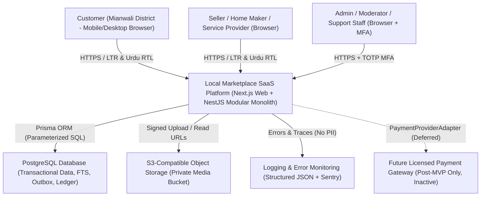
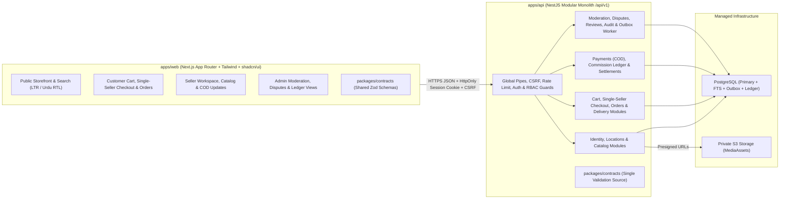

# System Architecture

> Status: Phase 2 Architecture Baseline (Design Only — Pending Final Founder Approval on Open Decisions in `docs/19_PHASE_2_OPEN_QUESTIONS.md`).

## 1. Architectural Direction & Constraints

The platform uses a **TypeScript `pnpm` monorepo** hosting a **Next.js App Router web client** (`apps/web`), a **NestJS modular-monolith REST API** (`apps/api`), and **shared Zod contracts/configurations** (`packages/contracts`, `packages/config`), backed by **PostgreSQL (Prisma ORM)** and **S3-compatible private object storage**.

### Explicitly Excluded from MVP
- Microservices, service meshes, Kubernetes, or Kafka.
- Redis / external caches or BullMQ (replaced by PostgreSQL-backed `OutboxEvent` and database indexes until throughput measurements justify Redis).
- Meilisearch / OpenSearch (replaced by PostgreSQL full-text search + `pg_trgm` trigram indexes).
- Live payment gateways, platform wallets, or escrow systems.
- Multi-seller combined checkout in one order.
- Automated UI generation replacing founder-owned Figma/screenshots.

---

## 2. System Context Diagram

---

## 3. Container & Component Architecture Diagram

---

## 4. Modular Monolith Module Boundaries & Data Ownership

**Strict Rule:** Each NestJS module owns its Prisma models/tables exclusively. Other modules may **never** import another module's Prisma repository or query its tables directly; cross-module reads/writes occur only via exported NestJS service interfaces or transactional domain events written to `OutboxEvent`.

| Module | Core Responsibilities | Exclusive Table Ownership | Allowed Module Dependencies |
|---|---|---|---|
| `auth` | Login, logout, password hashing (Argon2id), session lifecycle, CSRF tokens, password reset, email verification, admin MFA | `UserSession`, `AuthToken` | `users`, `audit` |
| `users` | Account registration, role assignment, `CustomerProfile`, private `Address` book | `User`, `Role`, `UserRole`, `CustomerProfile`, `Address` | `locations`, `audit` |
| `locations` | Multi-district geography (`Mianwali District` active for MVP), `AreaZone` management | `District`, `AreaZone` | None (foundational) |
| `seller-profiles` | Seller onboarding submission, private verification metadata (no CNIC/demographic fields in beta per `PQ-07`, `PQ-12`) | `SellerProfile` | `users`, `audit`, `notifications` |
| `stores` | Store setup, unique slug, service-area zones, strict privacy contact settings (`StoreMember` deferred post-MVP) | `Store`, `StoreServiceArea` | `seller-profiles`, `locations`, `media` |
| `categories` | Hierarchical product/service taxonomy (`en`/`ur` labels) | `Category` | None |
| `media` | Presigned S3 upload issuance, MIME/magic-byte & size checks, EXIF stripping, signed read URLs | `MediaAsset` | None |
| `products` | Product & variant CRUD, seller-scoped ownership, stock validation & atomic decrement | `Product`, `ProductImage`, `ProductVariant` | `stores`, `categories`, `media` |
| `services` | Service listing & package tier CRUD, immutable package snapshot providers | `ServiceListing`, `ServicePackage` | `stores`, `categories`, `media` |
| `search` | Public discovery over `ACTIVE` + `APPROVED` stores/listings using PostgreSQL FTS + `pg_trgm` | Read-only search views/queries via exported catalog read APIs | `products`, `services`, `stores`, `categories`, `locations` |
| `cart` | Store-scoped cart management (`User` + `Store` unique cart) | `Cart`, `CartItem` | `products`, `stores` |
| `checkout` | Server-side quote calculation, single-seller validation, idempotent order creation transaction | `IdempotencyKey` | `cart`, `products`, `services`, `stores`, `users`, `locations`, `orders`, `delivery`, `payments`, `commission-ledger` |
| `orders` | Physical & service order state machines, `OrderStatusHistory`, `OrderMessage` (REST text-only), cancellation, service revisions | `Order`, `OrderItem`, `ServiceOrderDetails`, `OrderStatusHistory`, `OrderMessage` | `outbox`, `audit` |
| `delivery` | Fulfilment mode (`SELLER_DELIVERY`, `CUSTOMER_PICKUP`), delivery tracking separated from COD payment | `Delivery` | `orders`, `locations`, `outbox` |
| `payments` | `PaymentProviderAdapter` interface, `COD_MANUAL` active implementation, explicit cash collection confirmation | `Payment`, `PaymentEvent`, `Refund` | `orders`, `commission-ledger`, `outbox`, `audit` |
| `commission-ledger` | Versioned `CommissionRule`, immutable `CommissionLedger`, offline `SellerSettlementRecord` | `CommissionRule`, `CommissionLedger`, `SellerSettlementRecord` | `orders`, `stores`, `categories`, `audit` |
| `reviews` | Verified completed-order reviews & ratings | `Review` | `orders`, `stores` |
| `notifications` | Async in-app notifications dispatched from `OutboxEvent` (privacy-safe payloads) | `Notification`, `OutboxEvent` | `users` |
| `moderation` | Seller & listing review queues, content `Report` handling | `Report` | `seller-profiles`, `stores`, `products`, `services`, `reviews`, `audit`, `notifications` |
| `disputes` | Customer/seller order & COD disputes, resolution outcomes | `Dispute` | `orders`, `payments`, `commission-ledger`, `audit`, `notifications` |
| `admin` | Admin staff operations, dashboard orchestration, district/system settings | None (orchestration facade) | All read/moderation services via explicit permissions |
| `analytics` | District pilot KPIs (activation, first sale, completion, COD refusal, GMV vs commission) | Read-only aggregate queries | `orders`, `commission-ledger`, `seller-profiles` |
| `audit` | Append-only privileged action logging | `AdminAuditLog` | None (foundational sink) |

---

## 5. Key Cross-Cutting Technical Decisions

### 5.1 Single-Source Contracts (`packages/contracts`)
- All request/response schemas, enum constants (`OrderStatus`, `DeliveryStatus`, `CodCollectionStatus`, `RoleName`), and error codes live in `packages/contracts` using Zod.
- NestJS consumes these Zod schemas directly via a global Zod validation pipe, and `apps/web` reuses the exact same schemas for client form validation and typed API responses.

### 5.2 Authentication & Session Design
- **Recommended MVP Baseline:** Server-managed opaque sessions stored in PostgreSQL (`UserSession`) with hashed session tokens, `HttpOnly`, `Secure`, `SameSite=Lax` cookies, and synchronizer/header CSRF validation on state-changing routes.
- **Why:** Immediate session revocation on logout, suspension, or password reset; zero JWT secret-rotation/blocklist complexity for a solo-maintained monolith.
- **Admin Hardening:** Staff roles (`MODERATOR`, `SUPPORT`, `ADMIN`, `SUPER_ADMIN`) require TOTP MFA verification (`POST /auth/admin/mfa/verify`) before privileged routes succeed.

### 5.3 Privacy-By-Projection & Media Safety
- Every public endpoint maps database rows through an explicit Public DTO Serializer that excludes residential addresses, personal phone numbers (`show_public_phone = false` by default), internal moderation notes, and internal user IDs where slugs suffice.
- Uploaded images go directly to a **private S3 bucket** via short-lived presigned PUT URLs, followed by server-side MIME/magic-byte validation and **EXIF metadata stripping** (removing GPS/device tags from home-based sellers' photos).

### 5.4 Asynchronous Processing Without Redis (`OutboxEvent`)
- State transitions (order placed, seller confirmed, COD collected, moderation decision) write an `OutboxEvent` row inside the **same PostgreSQL transaction** as the domain state change.
- A lightweight in-process NestJS scheduled poller (using `SELECT ... FOR UPDATE SKIP LOCKED`) processes pending outbox events idempotently to emit `Notification` rows or trigger internal ledger hooks.

### 5.5 Frontend & Founder-Owned UI/UX Boundary
- `apps/web` uses Next.js App Router route groups (`(public)`, `(customer)`, `(seller)`, `(admin)`) with `next-intl` (or equivalent i18n) supporting English (`dir="ltr"`) and Urdu (`dir="rtl"`), using Tailwind logical spacing utilities (`ms-*`, `me-*`, `ps-*`, `pe-*`).
- All visual tokens, typography, component styling (`shadcn/ui` overrides), and screen layouts are **strictly gated on founder-approved Figma frames/screenshots** (`D-005`).

### 5.6 Testing & Quality Architecture
- **Unit tests (Vitest/Jest):** Order state machines, commission basis-point rounding, single-seller validation, privacy serializers.
- **Integration tests (Supertest + real PostgreSQL):** Atomic checkout + stock decrement, concurrent stock race tests, idempotency replay, cross-seller IDOR negative tests, RBAC matrix checks.
- **E2E tests (Playwright):** Mobile + desktop viewports, Urdu RTL mirroring, guest browse → checkout → seller confirm → delivery → COD cash confirmation → commission ledger verification.
