# Entity Relationship Diagram (ERD)

> Status: Phase 2 Proposed ERD — Consistent with `docs/14_DATABASE_DESIGN.md`.
> Do not create migrations until the founder approves the database design.

## 1. Core Marketplace ERD

```mermaid
erDiagram
    USERS ||--o{ USER_ROLES : "assigned"
    ROLES ||--o{ USER_ROLES : "grants"
    USERS ||--o{ USER_SESSIONS : "owns"
    USERS ||--o{ AUTH_TOKENS : "issues"
    USERS ||--o| CUSTOMER_PROFILES : "has"
    USERS ||--o| SELLER_PROFILES : "has"
    USERS ||--o{ ADDRESSES : "saves"
    USERS ||--o{ NOTIFICATIONS : "receives"
    USERS ||--o{ ADMIN_AUDIT_LOGS : "performs"

    DISTRICTS ||--o{ AREA_ZONES : "contains"
    DISTRICTS ||--o{ STORES : "scopes"
    DISTRICTS ||--o{ ADDRESSES : "locates"
    DISTRICTS ||--o{ ORDERS : "scopes"
    AREA_ZONES ||--o{ STORE_SERVICE_AREAS : "covered_by"

    SELLER_PROFILES ||--o{ STORES : "operates"
    STORES ||--o{ STORE_SERVICE_AREAS : "serves"
    STORES ||--o{ PRODUCTS : "lists"
    STORES ||--o{ SERVICE_LISTINGS : "offers"
    STORES ||--o{ CARTS : "scoped_to"
    STORES ||--o{ ORDERS : "fulfils"
    STORES ||--o{ COMMISSION_LEDGER : "accounted_in"
    STORES ||--o{ SELLER_SETTLEMENT_RECORDS : "settles_via"

    CATEGORIES ||--o{ CATEGORIES : "parent_of"
    CATEGORIES ||--o{ PRODUCTS : "classifies"
    CATEGORIES ||--o{ SERVICE_LISTINGS : "classifies"
    CATEGORIES ||--o{ COMMISSION_RULES : "scopes"

    PRODUCTS ||--o{ PRODUCT_VARIANTS : "has"
    PRODUCTS ||--o{ PRODUCT_IMAGES : "displays"
    MEDIA_ASSETS ||--o{ PRODUCT_IMAGES : "stored_as"

    SERVICE_LISTINGS ||--o{ SERVICE_PACKAGES : "tiers"

    USERS ||--o{ CARTS : "owns"
    CARTS ||--o{ CART_ITEMS : "contains"
    PRODUCTS ||--o{ CART_ITEMS : "referenced_in"
    PRODUCT_VARIANTS ||--o{ CART_ITEMS : "selected_in"

    USERS ||--o{ ORDERS : "places"
    ORDERS ||--o{ ORDER_ITEMS : "snapshots_product"
    ORDERS ||--o| SERVICE_ORDER_DETAILS : "snapshots_service"
    ORDERS ||--o| DELIVERIES : "tracks_fulfilment"
    ORDERS ||--o{ ORDER_STATUS_HISTORY : "audits"
    ORDERS ||--o{ ORDER_MESSAGES : "threads"
    USERS ||--o{ ORDER_MESSAGES : "sends"
    ORDERS ||--o{ PAYMENTS : "tracks_cod"
    ORDERS ||--o{ COMMISSION_LEDGER : "generates"
    ORDERS ||--o{ REVIEWS : "receives"
    ORDERS ||--o{ DISPUTES : "escalates_to"

    PAYMENTS ||--o{ PAYMENT_EVENTS : "logs"
    PAYMENTS ||--o{ REFUNDS : "adjusts"
    COMMISSION_RULES ||--o{ ORDERS : "snapshotted_on"
    COMMISSION_RULES ||--o{ COMMISSION_LEDGER : "governs"
```

---

## 2. Detailed Entity Key Attributes

```mermaid
erDiagram
    USERS {
        uuid id PK
        string email UK
        string phone_e164 UK
        string display_name
        string status
        boolean mfa_enabled
        timestamptz created_at
    }

    DISTRICTS {
        uuid id PK
        string code UK
        string name_en
        string name_ur
        string province
        boolean is_active
    }

    AREA_ZONES {
        uuid id PK
        uuid district_id FK
        string name_en
        string name_ur
        string zone_type
        boolean is_active
    }

    SELLER_PROFILES {
        uuid id PK
        uuid user_id FK
        string seller_type
        string verification_status
    }

    STORES {
        uuid id PK
        uuid seller_profile_id FK
        uuid district_id FK
        string slug UK
        string display_name
        boolean show_public_phone
        boolean show_public_address
        bigint default_delivery_fee_paisa
        string status
    }

    ORDERS {
        uuid id PK
        string order_number UK
        uuid customer_id FK
        uuid store_id FK
        uuid district_id FK
        string order_type
        string status
        string payment_method
        string cod_collection_status
        string currency
        bigint subtotal_paisa
        bigint delivery_fee_paisa
        bigint total_paisa
        uuid commission_rule_id FK
        int commission_rate_bps
        bigint commission_amount_paisa
        bigint seller_net_entitlement_paisa
    }

    SERVICE_ORDER_DETAILS {
        uuid id PK
        uuid order_id FK
        uuid service_listing_id FK
        uuid service_package_id FK
        string service_mode_snapshot
        bigint package_price_paisa
        uuid area_zone_id FK
        jsonb service_address_snapshot_json
        timestamptz delivery_submitted_at
        timestamptz customer_accepted_at
    }

    DELIVERIES {
        uuid id PK
        uuid order_id FK
        string fulfilment_mode
        string delivery_status
        uuid area_zone_id FK
        jsonb shipping_address_snapshot_json
        timestamptz dispatched_at
        timestamptz delivered_at
    }

    PAYMENTS {
        uuid id PK
        uuid order_id FK
        string provider_code
        string payment_method
        string status
        bigint amount_paisa
        string currency
        string manual_payment_method_desc
        uuid confirmed_by_id FK
        timestamptz collected_at
    }

    ORDER_MESSAGES {
        uuid id PK
        uuid order_id FK
        uuid sender_id FK
        string sender_role
        text body
        timestamptz created_at
    }

    COMMISSION_RULES {
        uuid id PK
        int version
        string scope_type
        uuid category_id FK
        int rate_bps
        boolean include_delivery_fee
        boolean is_active
    }

    COMMISSION_LEDGER {
        uuid id PK
        uuid order_id FK
        uuid store_id FK
        uuid commission_rule_id FK
        string entry_type
        bigint commissionable_base_paisa
        int rate_bps
        bigint commission_paisa
        bigint seller_net_entitlement_paisa
        timestamptz created_at
    }

    SELLER_SETTLEMENT_RECORDS {
        uuid id PK
        uuid store_id FK
        string direction
        string settlement_method
        bigint amount_paisa
        string status
        timestamptz period_start
        timestamptz period_end
    }
```

---

## 3. Structural Guarantees Enforced by the ERD

1. **Single-Seller Order Guarantee:** `ORDERS.store_id` is a mandatory single foreign key (`NOT NULL`). One `Order` can never span multiple sellers or stores.
2. **Store-Scoped Cart Guarantee:** `CARTS` enforces `UNIQUE(customer_id, store_id)`, ensuring checkout operates on one seller store at a time.
3. **District Pilot Isolation:** `STORES.district_id`, `ADDRESSES.district_id`, and `ORDERS.district_id` reference `DISTRICTS`, allowing Mianwali District (`is_active = true`) to launch cleanly while enabling future districts via data configuration.
4. **Delivery vs. Cash Collection Separation:** `DELIVERIES.delivery_status` (physical orders only) and `ORDERS.cod_collection_status` / `PAYMENTS.status` live on distinct fields and tables so `DELIVERED` never implies `COLLECTED`. Service orders without physical shipping use `SERVICE_ORDER_DETAILS` (`service_address_snapshot_json` for `ON_SITE`/`HYBRID`, `NULL` for `REMOTE`).
5. **Partial Unique & Ledger Integrity:** Partial unique indexes enforce one active store per seller (`WHERE deleted_at IS NULL`), `NULL`-safe `CART_ITEMS` and `COMMISSION_RULES` uniqueness, at most one `COLLECTED` payment per order, and at most one `COMMISSION_ACCRUAL` entry per order.
6. **Historical Immutability:** `ORDER_ITEMS`, `SERVICE_ORDER_DETAILS`, `ORDER_STATUS_HISTORY`, `PAYMENT_EVENTS`, `COMMISSION_LEDGER`, and `ADMIN_AUDIT_LOGS` preserve exact order-time prices, rules, and audit trails regardless of subsequent edits.
