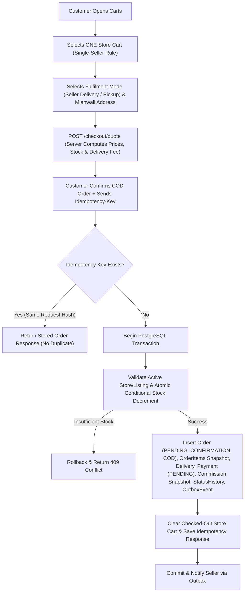
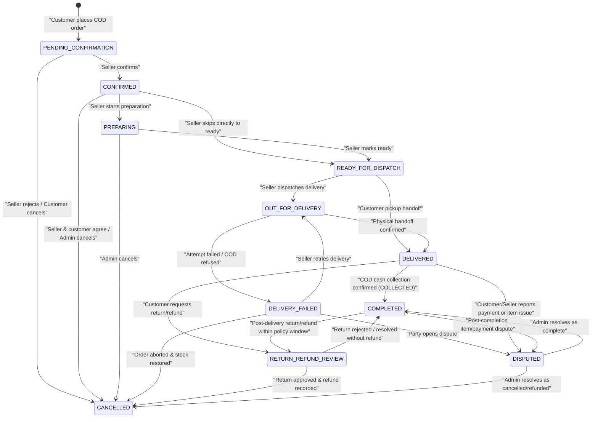
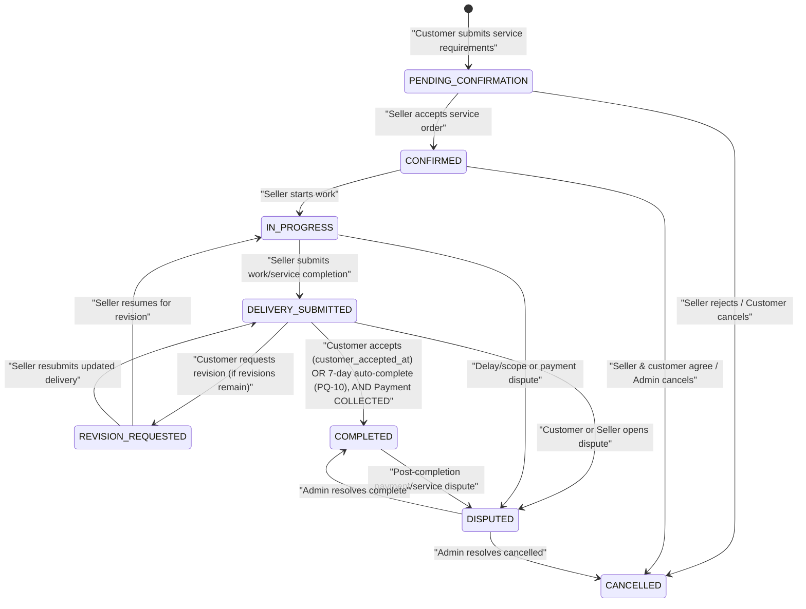

# Order & COD Workflows

> Status: Phase 2 Specification — Consistent with Single-Seller Checkout (`D-013`) and COD-Only MVP (`D-014`).

## 1. Core Workflow Principles

1. **Single-Seller Order Isolation:** Every `Order` belongs to exactly one `Store` (`store_id`). If a customer wants items from two stores in Mianwali District, they place two separate checkouts creating two independent orders.
2. **Distinct Physical vs. Service Workflows:** Physical goods (`order_type = PHYSICAL`) and services (`order_type = SERVICE`) share the `orders` core table and financial/audit infrastructure, while enforcing separate status state machines and detail tables (`order_items` + `deliveries` vs. `service_order_details`).
3. **Not Every Order Follows Every Status:**
   - Customer pickup orders transition `READY_FOR_DISPATCH` (or `READY_FOR_PICKUP`) → `DELIVERED` without passing through `OUT_FOR_DELIVERY`.
   - Cancelled or seller-rejected orders short-circuit directly to `CANCELLED`.
   - Service orders use `IN_PROGRESS` → `DELIVERY_SUBMITTED` → `REVISION_REQUESTED` / `COMPLETED` rather than physical shipping statuses.
4. **Delivery Confirmation ≠ Payment Collection:** Marking a COD order `DELIVERED` only confirms physical handoff. Cash collection is an **explicit, separate transition** (`cod_collection_status = COLLECTED` and `Payment.status = COLLECTED`).

---

## 2. Customer Single-Seller Checkout Flow

### Multi-Seller Purchases
- `carts` enforces `UNIQUE(customer_id, store_id)`.
- If a customer adds items from Store A and Store B, they maintain separate store carts and check out Store A and Store B individually—producing separate orders with independent `order_number`, `status`, `Delivery`, `Payment`, and `CommissionLedger` records.

---

## 3. Physical Product Order Lifecycle

### 3.1 Physical Statuses
| Status | Meaning |
|---|---|
| `PENDING_CONFIRMATION` | Order placed by customer; stock atomically decremented; awaiting seller confirmation |
| `CONFIRMED` | Seller accepted the order and committed to fulfil |
| `PREPARING` | Seller is packing/making the item (especially handmade/home-baked items) |
| `READY_FOR_DISPATCH` | Packed and ready for rider dispatch or customer pickup handoff |
| `OUT_FOR_DELIVERY` | Handed to seller's rider / local delivery courier |
| `DELIVERED` | Physical item handed to customer (COD cash may still be `PENDING_COLLECTION` until verified) |
| `COMPLETED` | Order delivered **AND** COD cash collection confirmed (`COLLECTED`) |
| `DELIVERY_FAILED` | Delivery attempt failed or COD refused at doorstep |
| `CANCELLED` | Cancelled by customer (within window), rejected by seller, or cancelled by Admin; stock restored |
| `RETURN_REFUND_REVIEW` | Post-delivery return/refund requested or under review |
| `DISPUTED` | Escalated customer/seller dispute awaiting Moderator/Admin resolution |

### 3.2 Seller & Physical Order Workflow Diagram

### 3.3 Actor Transition Matrix (Physical Orders)

| From Status | To Status | Permitted Actors | Mandatory Rules / Side Effects |
|---|---|---|---|
| `(new)` | `PENDING_CONFIRMATION` | `CUSTOMER` | `Idempotency-Key` required; atomic stock decrement |
| `PENDING_CONFIRMATION` | `CONFIRMED` | `SELLER` (owner) | Verifies store ownership |
| `PENDING_CONFIRMATION` | `CANCELLED` | `CUSTOMER` (owner), `SELLER` (reject), `ADMIN` | Reason required for seller/admin; restores stock atomically |
| `CONFIRMED` | `PREPARING` | `SELLER` (owner) | — |
| `CONFIRMED` | `READY_FOR_DISPATCH` | `SELLER` (owner) | Allowed shortcut for ready-stock items |
| `CONFIRMED` | `CANCELLED` | `SELLER` (mutual/agreed), `ADMIN` | Customer self-cancel is blocked after `CONFIRMED` (`PQ-10`); requires seller/admin handling and restores stock atomically |
| `PREPARING` | `READY_FOR_DISPATCH` | `SELLER` (owner) | Updates `Delivery.delivery_status = READY_FOR_HANDOFF` |
| `READY_FOR_DISPATCH` | `OUT_FOR_DELIVERY` | `SELLER` (owner) | Only when `fulfilment_mode != CUSTOMER_PICKUP`; sets `dispatched_at` |
| `READY_FOR_DISPATCH` | `DELIVERED` | `SELLER` (owner) | Pickup handoff; sets `delivered_at`; COD remains `PENDING_COLLECTION` |
| `OUT_FOR_DELIVERY` | `DELIVERED` | `SELLER` (owner), `ADMIN` | Sets `Delivery.delivery_status = DELIVERED`, `delivered_at` |
| `OUT_FOR_DELIVERY` | `DELIVERY_FAILED` | `SELLER` (owner), `ADMIN` | Sets `Delivery.delivery_status = FAILED`, records `failed_reason` |
| `DELIVERY_FAILED` | `OUT_FOR_DELIVERY` | `SELLER` (owner) | Re-attempt delivery |
| `DELIVERY_FAILED` | `CANCELLED` | `SELLER` (owner), `ADMIN` | Restores stock if item returned to seller |
| `DELIVERED` | `COMPLETED` | System (upon `SELLER` or `ADMIN` confirming COD `COLLECTED`) | Triggers `COMMISSION_ACCRUAL` ledger entry |
| `DELIVERED` / `COMPLETED` | `RETURN_REFUND_REVIEW` | `CUSTOMER` (owner), `ADMIN` | Requires reason within return window; triggers `Refund` review and `COMMISSION_REVERSAL` / `ADJUSTMENT` if approved |
| `DELIVERED` / `COMPLETED` / `DELIVERY_FAILED` | `DISPUTED` | `CUSTOMER` (owner), `SELLER` (owner), `ADMIN` | Creates `Dispute` record |
| `RETURN_REFUND_REVIEW` / `DISPUTED` | `COMPLETED` / `CANCELLED` | `MODERATOR`, `ADMIN` | Mandatory reason + `AdminAuditLog` + compensating ledger entry if needed |

> **Delivery Operator Note (`PQ-04`, `D-023`):** Approved MVP uses **seller-managed delivery and pickup only**. There is no platform rider fleet and no `DELIVERY_OPERATOR` role in MVP. The owning `SELLER` confirms dispatch, delivery, and COD collection; `ADMIN` may review or override disputed records with full audit logging.

---

## 4. Service Order Lifecycle (`ON_SITE`, `HYBRID`, `REMOTE`)

Service orders snapshot the selected `ServicePackage` and `service_mode_snapshot` into `service_order_details` at checkout (`PENDING_CONFIRMATION`). **Service orders (`ON_SITE`, `HYBRID`, and `REMOTE`) do not create a `deliveries` row**; instead:
- **`ON_SITE` services** (e.g., home repair, tailoring measurement, local in-person service): require a Mianwali `area_zone_id` and `service_address_snapshot_json` on `service_order_details`; cash is collected on-site (`COD`) upon completion.
- **`HYBRID` services** (e.g., in-person measurement/handoff + work delivery): snapshot `service_address_snapshot_json` when an in-person visit or local drop-off occurs; cash is collected on handoff (`COD`).
- **`REMOTE` services** (`PQ-14`, `D-019` — purely digital/remote delivery, `service_address_snapshot_json = NULL`): have **no physical `Delivery` record**. Payment is arranged directly offline with the seller (`Payment.payment_method = MANUAL_OFFLINE`). The seller manually confirms offline payment receipt (`POST /seller/orders/:id/manual-payment-confirmation`), recording confirmation timestamp (`collected_at`), confirming user (`confirmed_by_id`), optional `manual_payment_method_desc`, and `PaymentEvent` audit metadata.
  - **Independence Safeguards:** Seller payment confirmation does **not** automatically mark a service delivered or completed! `ServiceOrderDetails.customer_accepted_at` tracks customer acknowledgement separately from `Payment.status = COLLECTED`. Transition to `COMPLETED` requires **both** (`customer_accepted_at IS NOT NULL` **AND** `Payment.status = COLLECTED`). Thus, confirming upfront offline payment during `CONFIRMED`/`IN_PROGRESS` leaves the order in its active service workflow until delivery is submitted and accepted. This confirmation must never be represented as independent platform verification (no online gateway/wallet/escrow). Customer-facing wording, evidence requirements, and dispute rules remain `OPEN` before Milestone 5 build.
- **Cancellation & Auto-Completion (`PQ-10`, `D-036` — APPROVED):** Customers may self-cancel only while `PENDING_CONFIRMATION`. After `CONFIRMED`, cancellation requires seller agreement or Admin dispute resolution. Service orders remaining in `DELIVERY_SUBMITTED` for **7 days** with `Payment.status = COLLECTED` and no open revision or dispute auto-complete to `COMPLETED`.

---

## 5. Seven-Stage COD & Manual Payment Lifecycle Separation

To ensure financial integrity, orders track **order status**, **fulfilment/delivery status**, **cash/manual collection status**, and **commission ledger state** explicitly:

| Stage | Trigger / Action | `Order.status` | Physical `Delivery.delivery_status` / Service State | `Order.cod_collection_status` / `Payment.status` | Financial / Ledger Effect |
|---|---|---|---|---|---|
| **1. Order Created** | Customer submits checkout (`Idempotency-Key`) | `PENDING_CONFIRMATION` | Physical: `NOT_STARTED` / Service: `PENDING_CONFIRMATION` | `PENDING_COLLECTION` / `PENDING` | `CommissionRule` snapshotted on `Order`; **no ledger accrual yet** |
| **2. Seller Confirms Order** | `POST /seller/orders/:id/confirm` | `CONFIRMED` | Physical: `NOT_STARTED` / Service: `CONFIRMED` | `PENDING_COLLECTION` / `PENDING` | Physical stock remains committed |
| **3. Order Dispatched / Work Started** | `POST /seller/orders/:id/status` | Physical: `OUT_FOR_DELIVERY` (or `READY_FOR_DISPATCH`) / Service: `IN_PROGRESS` | Physical: `OUT_FOR_DELIVERY` (or `READY_FOR_HANDOFF`) / Service: N/A | `PENDING_COLLECTION` / `PENDING` *(or `COLLECTED` if upfront remote manual payment)* | No ledger accrual until fulfilled/accepted |
| **4. Delivery / Service Submitted** | `POST /seller/orders/:id/status` | Physical: `DELIVERED` / Service: `DELIVERY_SUBMITTED` | Physical: `DELIVERED` / Service: `customer_accepted_at` set on accept | **Does NOT auto-mark paid** | **Do NOT mark paid automatically** |
| **5. Cash / Payment Collection Confirmed** | `POST /seller/orders/:id/cod-collection` (COD) or `POST /seller/orders/:id/manual-payment-confirmation` (`REMOTE`) | `COMPLETED` (only once delivered/accepted & no open return/dispute) | Physical: `DELIVERED` / Service: `customer_accepted_at` set | `COLLECTED` / `COLLECTED` | `PaymentEvent` logged idempotently |
| **6. Commission Calculated** | System handler on eligible `COMPLETED` + `COLLECTED` | `COMPLETED` | Fulfilled | `COLLECTED` / `COLLECTED` | Single immutable `COMMISSION_ACCRUAL` inserted into `CommissionLedger` |
| **7. Seller Settlement Recorded** | `POST /admin/settlements` | `COMPLETED` | Fulfilled | `COLLECTED` / `COLLECTED` | Offline remittance recorded in `SellerSettlementRecord` (`SELLER_TO_PLATFORM`) |

---

## 6. Handling Edge Cases, Failures & Duplicate Updates

### 6.1 Failed Delivery & COD Refusal
- When a buyer is unreachable or refuses COD at the door, the seller records `DELIVERY_FAILED` (`Delivery.delivery_status = FAILED`, `failed_reason` recorded).
- If cash was not collected, `cod_collection_status` updates to `FAILED_REFUSED` upon order cancellation. No `COMMISSION_ACCRUAL` is posted to `CommissionLedger`.
- If the seller chooses to re-attempt delivery, status transitions `DELIVERY_FAILED` → `OUT_FOR_DELIVERY`. If aborted, `DELIVERY_FAILED` → `CANCELLED` restores stock once returned.

### 6.2 Cancellation, Messaging & Stock Restoration (`PQ-09`, `PQ-10`)
- **Customer Self-Cancellation (`PQ-10`):** Customers may self-cancel without admin intervention **only while `status = PENDING_CONFIRMATION`**. After `CONFIRMED`, cancellation requires seller approval or Admin dispute handling.
- **Stock Restoration:** Runs inside the same database transaction as the transition to `CANCELLED`, guarded by an atomic check (`WHERE status IN (...)`) so stock can **never** be double-restored on concurrent requests.
- **Order-Scoped Messaging (`PQ-09`, `D-021`):** Customers and sellers communicate via REST-only, text-only `order_messages` (no WebSockets, no attachments). Messaging freezes upon terminal order closure (`COMPLETED` or `CANCELLED`), subject to documented Support/Dispute exceptions, and enforces privacy warnings against sharing private phone numbers or residential addresses publicly.

### 6.3 Disputed Delivery
- Either party may open a `Dispute` (e.g., seller claims cash wasn't received or buyer claims damaged goods / missing items).
- Opening a dispute freezes automated completion/settlement and routes the case to `MODERATOR` / `ADMIN` with full `OrderStatusHistory`, `Delivery`, and `PaymentEvent` logs.

### 6.4 Duplicate Status Updates & Concurrency Protection
- **Idempotency Keys:** `POST /orders`, `POST /orders/services`, `POST /seller/orders/:id/cod-collection`, and `POST /seller/orders/:id/manual-payment-confirmation` require an `Idempotency-Key` stored in `idempotency_keys` (`UNIQUE(user_id, endpoint, key_value)`). Replaying the same request returns the original response; reusing the same key with a different payload returns `409 Conflict`.
- **Optimistic State-Machine Guard:** Every status transition executes inside a PostgreSQL transaction using conditional update / `SELECT ... FOR UPDATE` on `orders` checking the expected `from_status`. Concurrent conflicting transitions (e.g., customer cancelling at the exact instant seller dispatches) fail deterministically with `409 Conflict` (`INVALID_STATE_TRANSITION`).
- **Audit Trail:** Every accepted transition appends a row to `order_status_history` with `actor_id`, `actor_role`, `from_status`, `to_status`, `reason`, and UTC timestamp.
