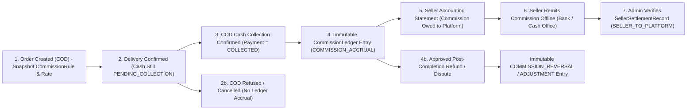

# Commission & Financial Model

> Status: Phase 2.2 Financial Architecture Specification (`PQ-01`, `PQ-02`, `PQ-03`, `PQ-13`, `PQ-14`, `PQ-15` Integrated).
> **Promotional Closed Beta Policy (`PQ-01`):** Initial commission rate is **0% (`0 bps`)** during the Mianwali District closed beta, with delivery fees excluded (`include_delivery_fee = false`, `PQ-02`). No commission is charged to sellers during the promotional beta, while immutable zero-value `CommissionLedger` audit records are still logged and `CommissionRule` remains configurable for future post-beta activation. Post-beta settlement cadence (monthly vs. biweekly), grace periods, and overdue thresholds remain `OPEN` (`PQ-03`).

---

## 1. Core Financial Guardrails

1. **COD Only in MVP:** Cash on Delivery is the sole active payment method. Online payment gateways are deferred behind `PaymentProviderAdapter` and are **not** integrated in MVP.
2. **No Wallet, No Escrow, No Automated Transfers:** The platform does **not** hold customer funds in a wallet or escrow, and does **not** execute automated bank payouts.
3. **Accounting vs. Cash Movement Separation:**
   - **Delivery ≠ Payment:** `Delivery.delivery_status = DELIVERED` does not mark a COD order paid.
   - **Calculated ≠ Collected ≠ Settled:** The system explicitly separates:
     - *Calculated snapshot* at order creation (`orders.commission_amount_paisa`),
     - *Actual cash collected* from customer (`payments.status = COLLECTED` / `orders.cod_collection_status = COLLECTED`),
     - *Accrued commission obligation* (`commission_ledger`), and
     - *Offline settlement transfer* between seller and platform (`seller_settlement_records`).
4. **Integer Minor Units Only:** All money uses `BIGINT` minor units (`paisa`, `1 PKR = 100 paisa`), and all rates use integer basis points (`rate_bps`, `100 bps = 1.00%`). Floating-point arithmetic is strictly forbidden.

---

## 2. COD Financial Lifecycle Diagram



---

## 3. Configurable Commission Rules (`commission_rules`)

### 3.1 Rule Resolution & Mixed-Category Orders (`PQ-15`, `D-020`)
Rules are versioned and time-bounded (`effective_from`, `effective_to`, `is_active`).
- **Approved MVP Resolution (`PQ-15`):** MVP enforces **one applicable `GLOBAL` or `ORDER_TYPE` (`PHYSICAL` | `SERVICE`) flat commission rule per order**—seeded at `0 bps` for the Mianwali closed beta (`PQ-01`).
- **No Per-Item Category Commission in MVP:** Mixed-category single-seller carts resolve unambiguously to the single order-level `GLOBAL` or `ORDER_TYPE` rule (so mixed-category orders never create split or ambiguous calculations).
- **Future Extensibility:** `commission_rules` retains `scope_type = 'CATEGORY'` and `category_id` (and `order_items` documents nullable item-level snapshot columns) so category-specific rules can be introduced post-MVP without breaking historical order snapshots.

### 3.2 Commission Calculation Basis, Delivery Fee Ownership & Unified Formula (`PQ-02`, `PQ-13`)
- **Delivery Fee Ownership (`PQ-13`, `D-018` — APPROVED):** Under seller-managed delivery in MVP (`SELLER_DELIVERY` / `CUSTOMER_PICKUP`), the **seller sets, collects (via COD), and owns/retains `delivery_fee_paisa`**.
- **Commissionable Base (`include_delivery_fee = false`, `PQ-02` — APPROVED):**
  - Delivery fees are **excluded** from the platform commission calculation:
    $$\text{commissionable\_base\_paisa} = \text{subtotal\_paisa} - \text{discount\_paisa}$$
  - *(The `include_delivery_fee` flag remains `false` in MVP; `discount_paisa = 0` or seller-funded store discount only.)*
- **Deterministic Integer Calculation (Half-Up Rounding in Paisa):**
  $$\text{commission\_paisa} = \left\lfloor \frac{\text{commissionable\_base\_paisa} \times \text{rate\_bps} + 5000}{10000} \right\rfloor$$
  *(During the 0% promotional closed beta where `rate_bps = 0`, `commission_paisa = 0`.)*
- **Unified Seller Net Entitlement Definition (`seller_net_entitlement_paisa`):**
  $$\text{seller\_net\_entitlement\_paisa} = \text{total\_paisa} - \text{commission\_paisa}$$
  where $\text{total\_paisa} = (\text{subtotal\_paisa} - \text{discount\_paisa}) + \text{delivery\_fee\_paisa}$.
  - **Accounting Meaning Only:** Under seller-managed delivery, this is the seller's **total economic entitlement** (net item proceeds plus seller-retained delivery fee, after platform commission). It is **not** a withdrawable wallet balance, escrow, or guaranteed platform payout.
  - **COD / Offline Cash Flow Reality:** The seller collects `total_paisa` directly from the buyer, retains `seller_net_entitlement_paisa`, and—once non-zero commission is activated post-beta (`PQ-03`)—owes `commission_paisa` to the platform via offline `SellerSettlementRecord` (`SELLER_TO_PLATFORM`). During the 0% promotional beta, `commission_paisa = 0` and no remittance is due.

---

## 4. Order-Time Snapshots vs. Immutable Ledger Entries

### 4.1 Snapshot at Order Creation (`orders`)
At checkout, `orders` records `commission_rule_id`, `commission_rate_bps`, `commission_amount_paisa`, and `seller_net_entitlement_paisa`.
- Subsequent edits or new versions of `CommissionRule` **never** alter existing orders.
- At this stage, **no `CommissionLedger` entry is posted yet** because the COD order is not yet delivered and collected.

### 4.2 Immutable Ledger Posting (`commission_ledger`)
`commission_ledger` is strictly **append-only** (no `UPDATE` or `DELETE` operations permitted in application code or DB roles):

| Entry Type | Trigger Event | Sign of `commission_paisa` | Meaning |
|---|---|---|---|
| `COMMISSION_ACCRUAL` | Order reaches `COMPLETED` **and** payment collection confirmed (`COLLECTED`) | `+` (`0` during 0% beta, or `> 0` post-beta) | Audit record of platform commission on verified completed COD / manual order |
| `COMMISSION_REVERSAL` | Full cancellation/refund approved after accrual | `-` (negative, referencing original entry) | Reverses accrued commission |
| `ADJUSTMENT` | Partial refund or Admin dispute resolution | `+` or `-` (with `reference_entry_id` & `reason`) | Corrects ledger balance transparently |
| `SETTLEMENT_OFFSET` | Optional reconciliation marker when needed | `0` or signed offset | Links reconciled period to `SellerSettlementRecord` |

---

## 5. COD Collection, Refunds & Cancellations

1. **Pre-Collection Cancellation / COD Refusal:** Because no `COMMISSION_ACCRUAL` is posted until `COMPLETED` + `COLLECTED`, cancelled or refused COD orders result in zero accrued commission without cluttering the ledger with fake reversals.
2. **Post-Completion Return / Refund (COD):**
   - If a customer returns a product after COD cash was collected and seller refunds the buyer directly (cash/bank), an Admin reviews `Refund` / `Dispute`.
   - Once verified `RECORDED`, the system appends an immutable `COMMISSION_REVERSAL` (full refund) or `ADJUSTMENT` (proportional partial refund) referencing the original `COMMISSION_ACCRUAL`.
3. **Seller Accounting Statement (Not a Wallet):**
   - The Seller dashboard displays:
     - **Verified COD Sales Collected** (sum of `total_paisa` for `COLLECTED` orders),
     - **Accrued Platform Commission** (sum of `commission_paisa` in `commission_ledger`),
     - **Settled / Remitted Commission** (sum of verified `SellerSettlementRecord` where `direction = 'SELLER_TO_PLATFORM'`),
     - **Outstanding Commission Owed** (`Accrued - Settled`).
   - UI copy must explicitly state this is an **accounting statement, not a withdrawable wallet**.

---

## 6. Payment Provider Abstraction (`PaymentProviderAdapter`)

Even though COD is the only active MVP method, `payments` defines a strict adapter interface so future licensed gateways (e.g., bank/card/wallet PSPs) can be added without modifying `orders` or `commission_ledger`:

```text
PaymentProviderAdapter
├── providerCode: string                  // 'COD_MANUAL' in MVP; future PSP codes later
├── initiatePayment(order): PaymentResult // Creates PENDING COD record; future returns redirect/intent
├── verifyWebhook(headers, rawBody)       // No-op/unsupported in COD; mandatory HMAC/sig check later
├── confirmCollection(payment, actor)     // Explicit COD cash confirmation; future PSP capture event
└── recordRefund(payment, amount, reason) // Records offline COD refund or future PSP refund API
```

---

## 7. Reconciliation Requirements

Before Closed Beta and on a recurring operational schedule, Admin/Finance reports must verify four invariants:
1. **Collection Integrity:** Count of orders with `status = COMPLETED` and `cod_collection_status != COLLECTED` must equal `0`.
2. **Accrual Completeness:** Every order with `status = COMPLETED` and `cod_collection_status = COLLECTED` has exactly one active `COMMISSION_ACCRUAL` entry (unless reversed by a linked `COMMISSION_REVERSAL`).
3. **Ledger Immutability:** `commission_ledger` contains zero modified/deleted rows (`AdminAuditLog` + DB privilege enforcement).
4. **Settlement Balance Check:** For every store, `SUM(commission_ledger.commission_paisa) - SUM(verified SELLER_TO_PLATFORM settlements)` equals the store's `Outstanding Commission Owed`.
