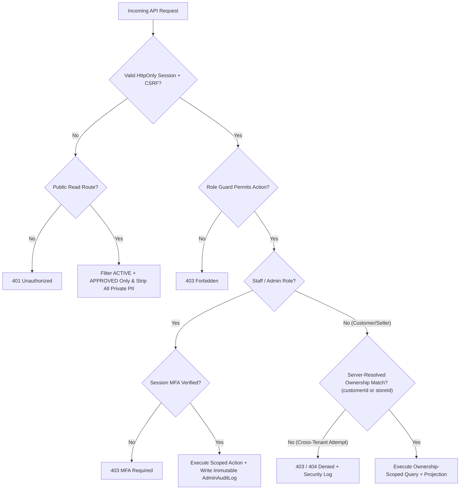

# Authorization & Role-Permission Matrix

> Status: Phase 2 Security & Access Control Baseline.
> All permissions **must be enforced server-side** inside NestJS guards and domain services—never solely in the Next.js UI.

---

## 1. Roles & Dual-Role Model

A single `User` account can hold multiple roles via `user_roles`:
- **`GUEST`**: Unauthenticated visitor browsing public `ACTIVE` + `APPROVED` stores, products, and services in Mianwali District.
- **`CUSTOMER`**: Default role upon registration; manages own profile, addresses, store-scoped carts, own orders, and eligible reviews.
- **`SELLER`**: User with an approved `SellerProfile` and `Store`; retains `CUSTOMER` capabilities when buying from *other* stores, while managing *only their own* store, listings, orders, and ledger statements.
- **`MODERATOR`**: Platform trust/safety staff; reviews seller applications, approves/rejects listings, and resolves content `Report`s and order `Dispute`s (with MFA + audit logs). Cannot configure commission rates or manage staff roles.
- **`SUPPORT`**: Customer/seller support staff; inspects order/delivery status and disputes to assist users (with MFA + audit logs). Cannot alter commission rules, financial settlements, or admin access.
- **`ADMIN`**: Platform operations manager; manages users, stores, orders, disputes, and verifies manual `SellerSettlementRecord` entries (with MFA + audit logs). Cannot create `SUPER_ADMIN` accounts or modify top-level security/commission governance unless granted.
- **`SUPER_ADMIN`**: Highest privileged operator; manages `CommissionRule` versions, staff role assignments (`MODERATOR`/`SUPPORT`/`ADMIN`), and system district activation (with MFA + audit logs).

*(Note (`PQ-04`, `D-023`): Seller-managed delivery and pickup only in MVP; there is no platform rider fleet and no `DELIVERY_OPERATOR` role in MVP.)*

---

## 2. Authorization Boundaries Diagram

---

## 3. Server-Side Ownership & Privacy Rules

1. **Cross-Seller Isolation:**
   - Every seller endpoint resolves `store_id` from the authenticated user's `SellerProfile` on the server—never from an untrusted request body/query param.
   - Seller A can **never** view, edit, confirm, cancel, or inspect Seller B's products (including drafts), orders, customer delivery addresses, commission ledger entries, or settlements.
   - Attempting to access another store's private resource must return `403` or `404` consistently without leaking metadata.
2. **Self-Dealing Guard:** A user who is both `CUSTOMER` and `SELLER` must be prevented from placing orders or writing reviews on their **own** store's listings (`order.customer_id != store.seller_profile.user_id`).
3. **Private Location & Contact Protection:**
   - `Store.public_contact_phone` and `Store.public_business_address` remain `null` / hidden unless the seller explicitly opts in (`show_public_phone = true` / `show_public_address = true`).
   - Public endpoints return **only** `District` (`Mianwali District`) and `StoreServiceArea` (`AreaZone` names) by default.
   - Customer delivery `Address` snapshots (`Delivery.shipping_address_snapshot_json`) are visible only to:
     1) the owning `CUSTOMER`,
     2) the fulfilling `SELLER` (for that specific active order), and
     3) authorized `SUPPORT` / `ADMIN` staff (audited on access if sensitive PII is viewed).
4. **Mandatory Auditability:** Every `MODERATOR`, `SUPPORT`, `ADMIN`, and `SUPER_ADMIN` mutation (and sensitive order/PII lookup) writes an immutable `AdminAuditLog` record containing `actor_id`, `actor_role`, `action`, `target_type`, `target_id`, `reason`, and before/after snapshots.
5. **Order-Scoped Messaging & Pickup Privacy (`PQ-09`, `D-021` — APPROVED):**
   - **No Real-Time Chat / No WebSockets:** Standard REST endpoints only (`GET`/`POST /orders/:id/messages`).
   - **Ownership & Visibility:** Accessible strictly to the order's `customer_id`, the order's `store_id` seller, and authorized `SUPPORT`/`MODERATOR`/`ADMIN` staff (staff access logged via `AdminAuditLog`).
   - **Pickup Instructions Protection:** `deliveries.pickup_instructions` (e.g., safe handoff landmark) are hidden until `Order.status = CONFIRMED`, and sellers are warned never to post residential addresses or private phone numbers publicly.
   - **Attachment & Retention Policy:** Text-only in MVP (no attachments). Messaging freezes upon terminal order closure (`COMPLETED` or `CANCELLED`), subject to documented Support/Dispute exceptions, and follows the order retention/redaction schedule.
6. **Women-Led / Demographic Data Exclusion (`PQ-12`, `D-029` — APPROVED):**
   - Women-led identification/consent fields (`women_led_self_id`, `women_led_consent`) are **excluded from the database** during the initial closed beta. Demographic attributes must never be exposed publicly or used for search ranking, moderation priority, or commissions. Any future collection requires explicit founder approval and a formal privacy review.
7. **Remote Service Manual Payment Confirmation (`PQ-14`, `D-019`):**
   - Only the owning `SELLER` (or `ADMIN` override with `AdminAuditLog`) may confirm manual offline payment receipt on a `REMOTE` service order. Seller confirmation is logged as a seller-reported event (`confirmed_by_id`, `collected_at`, `PaymentEvent`) and never represented as independent platform verification.

---

## 4. Role–Permission Matrix

Legend: `—` = Denied · `Own` = Strictly own resource (`customer_id` or `store_id`) · `Public` = `ACTIVE` & `APPROVED` only (PII stripped) · `Full` = Platform-wide (audited) · `Masked` = PII masked unless required for active ticket.

| Capability / Resource | GUEST | CUSTOMER | SELLER | MODERATOR | SUPPORT | ADMIN | SUPER_ADMIN |
|---|---|---|---|---|---|---|---|
| Browse active stores, products, services, search | `Public` | `Public` | `Public` | `Public` | `Public` | `Public` | `Public` |
| Manage own profile & saved Mianwali addresses | — | `Own` | `Own` | `Own` | `Own` | `Own` | `Own` |
| Manage store-scoped cart & place single-seller COD order | — | `Own` | `Own` (other stores only) | — | — | — | — |
| View own customer orders & status history | — | `Own` | `Own` | — | — | — | — |
| Cancel own order (within policy window) | — | `Own` | — | — | — | `Full` (reason) | `Full` (reason) |
| Submit seller onboarding & manage store settings | — | `Apply` | `Own` | — | — | — | — |
| Create/edit/archive products, variants & services | — | — | `Own` | — | — | — | — |
| Upload media & request signed URLs | — | — | `Own` | — | — | — | — |
| View seller orders & customer fulfilment address | — | — | `Own` (active orders) | — | `Masked` | `Full` | `Full` |
| Confirm/reject/prepare/dispatch/deliver seller order | — | — | `Own` | — | — | `Full` (override w/ reason) | `Full` |
| View & post text-only `order_messages` (frozen after closure except disputes) | — | `Own` | `Own` | `Full` (audited) | `Full` (audited) | `Full` (audited) | `Full` (audited) |
| Confirm COD / manual offline payment collection (`COLLECTED` / `FAILED`) | — | — | `Own` | — | — | `Full` (audited) | `Full` |
| View commission summary, ledger & settlements | — | — | `Own` (read-only) | — | — | `Full` | `Full` |
| Post review on completed eligible order | — | `Own` | `Own` (other stores only) | — | — | — | — |
| Submit abuse/listing/review report | — | `Own` | `Own` | — | — | — | — |
| Open order/COD dispute | — | `Own` | `Own` | — | — | — | — |
| Approve/reject seller profiles & listings | — | — | — | `Full` | — | `Full` | `Full` |
| Suspend/unsuspend users or stores | — | — | — | — | — | `Full` | `Full` |
| Resolve reports & order disputes | — | — | — | `Full` | `Assist` (no financial reversal) | `Full` | `Full` |
| Record/verify `SellerSettlementRecord` | — | — | — | — | — | `Full` | `Full` |
| Create/version `CommissionRule` policies | — | — | — | — | — | — | `Full` |
| Manage districts (`is_active`), staff roles & MFA resets | — | — | — | — | — | — | `Full` |
| Read `AdminAuditLog` | — | — | — | — | — | `Full` (read-only) | `Full` (read-only) |
